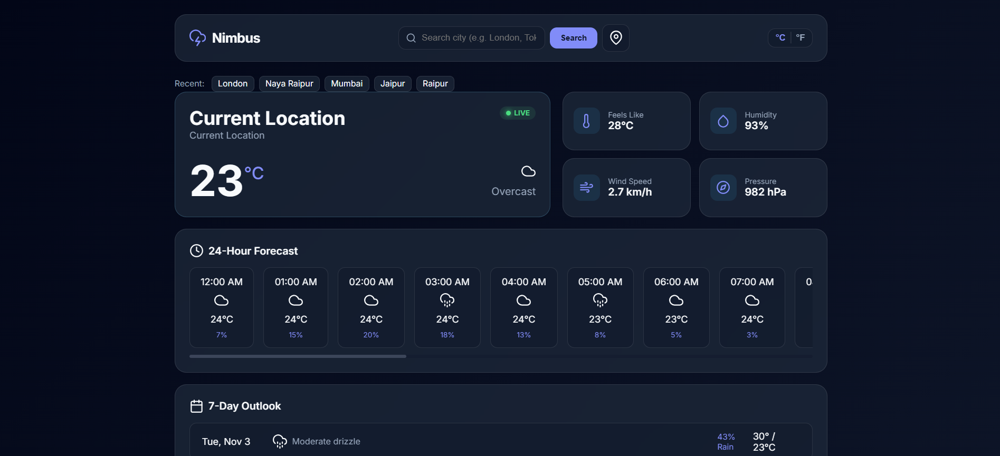
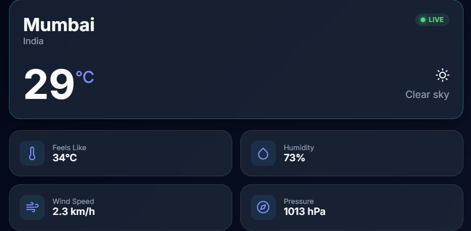
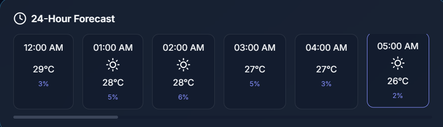
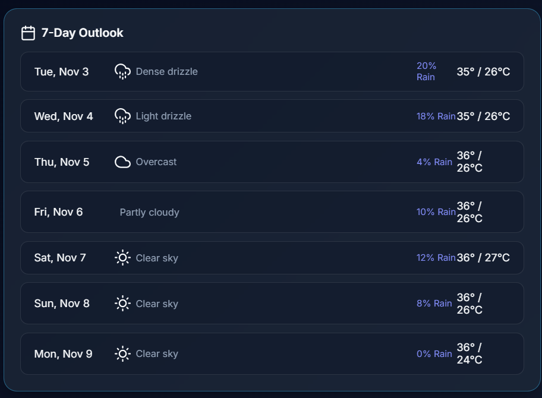
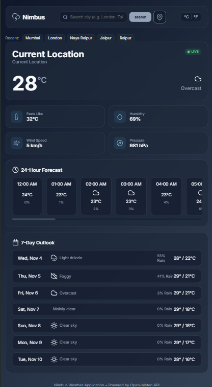

# Nimbus — Weather Forecast Application

A modern, responsive weather dashboard built with Python and Flask.  
Get real-time weather conditions, hourly updates, and upcoming forecasts through a clean and interactive interface.



---

## Overview

**Nimbus** is a full-stack weather forecast application developed using Python and Flask. It integrates the Open-Meteo Weather API and Geocoding API to retrieve real-world meteorological information and present it through an interactive dashboard.

Users can search for cities, access weather information based on their current location, explore hourly weather trends, and view upcoming daily forecasts.

The application combines a lightweight Flask backend with a responsive frontend to provide a practical and accessible weather experience.

Developed as **Project 03** during the **Pinnacle Labs Python Developer Internship**.

## Features

### Weather Information
- **City Search:** Retrieve weather information by searching for a city.
- **Current Location:** Detect the user's location through the browser Geolocation API.
- **Current Conditions:** View temperature, weather conditions, and weather icons.
- **Weather Metrics:** Access humidity, wind speed, atmospheric pressure, and other available measurements.

### Forecasting
- **Hourly Forecast:** Explore upcoming hourly temperature and precipitation information.
- **7-Day Forecast:** View daily weather conditions with minimum and maximum temperatures.
- **Weather Visualization:** Understand changing weather conditions through intuitive visual elements.

### User Experience
- **Temperature Conversion:** Switch between Celsius and Fahrenheit.
- **Recent Searches:** Access previously searched cities through browser localStorage.
- **Dynamic Weather Themes:** Adapt the dashboard's appearance to weather conditions and time of day.
- **Responsive Interface:** Designed for desktop, tablet, and mobile screens.
- **Error Handling:** Display appropriate feedback for invalid searches, unavailable locations, and API failures.

## Application Preview

<!-- Add your actual application screenshots inside the screenshots folder. -->

<p align="center">
  
  <br>
  <em>Nimbus — Main Weather Dashboard</em>
</p>

### Current Weather

<p align="center">
  
</p>

### Hourly Forecast

<p align="center">
  
</p>

### Weekly Forecast

<p align="center">
  
</p>

### Responsive Interface

<p align="center">
  
</p>

> Replace or remove screenshot references if the corresponding image files are not available.

## Technology Stack

| Technology | Purpose |
|---|---|
| Python 3.10+ | Backend application logic |
| Flask 3.x | Web framework and application routing |
| HTML5 | Frontend structure |
| CSS3 | Styling and responsive layouts |
| JavaScript ES6+ | Dynamic interactions and asynchronous requests |
| Open-Meteo API | Weather information |
| Open-Meteo Geocoding API | City search and location coordinates |
| Requests | HTTP communication with external APIs |
| python-dotenv | Environment configuration |
| unittest | Automated testing |

## Application Architecture

Nimbus follows a simple service-oriented Flask architecture.

```text
                 USER
                   |
                   v
          FRONTEND INTERFACE
           HTML / CSS / JS
                   |
                   v
             FLASK SERVER
                   |
                   v
           WEATHER SERVICE
                   |
          +--------+--------+
          |                 |
          v                 v
     GEOCODING API     WEATHER API
          |                 |
          +--------+--------+
                   |
                   v
            WEATHER DATA
                   |
                   v
          FLASK RESPONSE
                   |
                   v
          DYNAMIC DASHBOARD
```

### How It Works

1. The user searches for a city or shares their current location.
2. The frontend sends a request to the Flask backend.
3. The backend communicates with the appropriate Open-Meteo endpoint.
4. The weather service processes and organizes the returned information.
5. Flask sends the result to the frontend.
6. JavaScript updates the dashboard with the latest weather information.

## Project Structure

```text
nimbus-weather/
│
├── app.py
├── config.py
├── requirements.txt
├── .env.example
├── .gitignore
├── README.md
│
├── services/
│   ├── __init__.py
│   └── weather_service.py
│
├── templates/
│   ├── base.html
│   └── index.html
│
├── static/
│   ├── css/
│   │   └── style.css
│   │
│   └── js/
│       └── script.js
│
├── screenshots/
│   ├── homepage.png
│   ├── current-weather.png
│   ├── hourly-forecast.png
│   ├── weekly-forecast.png
│   └── mobile-view.png
│
└── tests/
    ├── __init__.py
    └── test_weather_service.py
```

### Important Components

- `app.py` — Flask application initialization and route handling.
- `config.py` — Application configuration.
- `services/weather_service.py` — Weather API integration and data processing.
- `templates/` — HTML templates.
- `static/css/` — Application styles and responsive design.
- `static/js/` — Frontend interactions and asynchronous API communication.
- `tests/` — Automated unit and integration tests.

## Getting Started

Follow these instructions to run Nimbus locally.

### Prerequisites

Make sure you have installed:

- Python 3.10 or higher
- Git
- Visual Studio Code (recommended)
- A modern web browser

### 1. Clone the Repository

```powershell
git clone YOUR_GITHUB_REPOSITORY_URL
```

Navigate into the project directory:

```powershell
cd nimbus-weather
```

### 2. Create a Virtual Environment

```powershell
python -m venv venv
```

### 3. Activate the Environment

For Windows PowerShell:

```powershell
.\venv\Scripts\Activate.ps1
```

### 4. Install Dependencies

```powershell
pip install -r requirements.txt
```

### 5. Configure Environment Variables

Create a local `.env` file from the example:

```powershell
Copy-Item .env.example .env
```

Configure the variables required by your application.

Open-Meteo's standard weather and geocoding endpoints do not require an API key. If the application uses only these endpoints, no API key is necessary.

Never commit private credentials or sensitive environment variables to GitHub.

### 6. Run the Application

```powershell
python app.py
```

Open your browser and visit:

**http://127.0.0.1:5000/**

The Nimbus weather dashboard should now be available locally.

## Running Tests

Nimbus includes automated tests using Python's built-in `unittest` framework.

Run the test suite using:

```powershell
python -m unittest
```

Tests are intended to verify:

- Weather service functionality.
- API response processing.
- Error handling.
- Flask application endpoints.
- Expected application behavior.

## Weather API

Nimbus uses services provided by **Open-Meteo**.

| API | Purpose |
|---|---|
| Open-Meteo Weather API | Retrieves current and forecast weather information |
| Open-Meteo Geocoding API | Converts city names into geographical coordinates |

Official documentation:

- [Open-Meteo Weather API](https://open-meteo.com/en/docs)
- [Open-Meteo Geocoding API](https://open-meteo.com/en/docs/geocoding-api)

Open-Meteo provides weather data through HTTP-based API endpoints, making it suitable for lightweight applications and development projects.

## Development Highlights

This project provides practical experience with:

- Developing web applications using Flask.
- Integrating third-party REST APIs.
- Processing JSON responses.
- Handling asynchronous frontend requests.
- Implementing browser geolocation.
- Managing frontend and backend communication.
- Building responsive user interfaces.
- Handling API errors and unexpected responses.
- Writing automated tests using Python.

## Future Improvements

Potential improvements for future versions include:

- Weather alerts and severe-weather notifications.
- Favorite cities and personalized locations.
- Extended forecast information.
- Historical weather data visualization.
- Improved accessibility.
- Additional weather charts and visualizations.
- Progressive Web App support.

These are potential enhancements and are not necessarily part of the current implementation.

## License

This project is intended to be distributed under the MIT License.

See the `LICENSE` file for details.

## Acknowledgements

- **Pinnacle Labs** — For providing the opportunity to develop this project as part of the Python Developer Internship.
- **Open-Meteo** — For providing accessible weather and geocoding data.
- The open-source Python and Flask communities.

---

<p align="center">
  <strong>Built with Python, Flask, and curiosity.</strong>
  <br>
  Nimbus — Making weather information easier to explore.
</p>